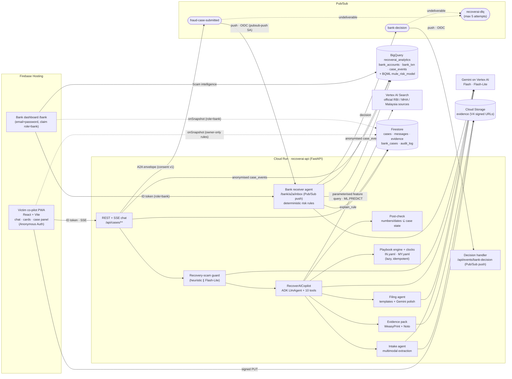

# RecoverAI

**A co-pilot that helps scam victims try to get their money back.** The victim chats in Hindi, Malay or English and uploads a payment screenshot, the scammer's messages or a voice note. RecoverAI then:

1. extracts the transaction facts with Gemini (multimodal, with confidence scores),
2. builds the country-specific recovery plan (India 1930 / NCRP / bank; Malaysia NSRC 997 / bank) from a YAML playbook,
3. drafts every complaint at once (hotline script, portal complaint, bank letter) and a Hindi-capable evidence-pack PDF,
4. tracks the legal deadlines and escalates on its own (RBI Ombudsman on day 31),
5. hands the case, with consent, to a **bank fraud-desk agent**: an A2A envelope published on **Pub/Sub** (`fraud-case-submitted`). That agent queries the beneficiary account's real transaction history in **BigQuery**, scores mule-account signals with deterministic rules (plus an advisory **BigQuery ML** score), and recommends a temporary, amount-limited debit hold. A human analyst decides, and the decision flows back over Pub/Sub (`bank-decision`) to the victim's chat.
6. grounds explanations of rules in official sources through **Vertex AI Search**, with citations.
7. A **recovery-scam guard** runs before the co-pilot on every message.

> **Disclaimer:** RecoverAI is a hackathon prototype. It drafts documents and reminders. It is not legal advice, it never handles money, and it never charges victims. All decisions are taken by government agencies and your bank. Every bank account, person and transaction in this repo is synthetic.

Rules, arithmetic, amounts and dates are computed **in code**, never by the model. The model writes prose, and a post-check verifies every number and date it emits against the case state before the text reaches the user.

---

## Architecture



* **Victim flow:** chat → Upload card → Facts card (confidence colours, editable) → Plan card + clocks → Drafts card + evidence pack → Consent card → bank. The case panel updates live through Firestore listeners.
* **Bank flow (F15 + F14):** on consent the API publishes the A2A `fraud_case.submit` envelope to `fraud-case-submitted`. Pub/Sub pushes it, with an OIDC token minted for the `pubsub-push` service account, to the receiver agent. The agent verifies the token (audience + email), dedupes on `caseId + sent_at` (`processed_events/{id}`, deterministic bank-case id), and runs one parameterised BigQuery query over `bank_txn` (`backend/sql/features.sql`) for `account_age_days`, `credits_24h`, `distinct_senders_24h`, `outflow_60m_pct` and `credit_ratio_vs_avg`. The features are cached on the bank case and shown as "from transaction data". Signals are computed per PRD §10 (VICTIM_REPORT, RECENT_TXN, NEW_ACCOUNT, FAN_IN, RAPID_OUTFLOW, FLAGGED_NUMBER, PROFILE_MISMATCH), giving a score, a level and an action. If BigQuery is unavailable, the case-only signals are used and the case carries a note. Gemini writes the reason (capped at 15 s, with a template fallback, so the push is acked inside its 30 s deadline). The analyst approves, rejects or asks for more info. Each decision goes to `audit_log` and `case_events`, and is published to `bank-decision`, whose push handler posts it idempotently into the victim's chat in their language. Failed deliveries retry with backoff and land in `recoverai-dlq` after 5 attempts.
* **Scam intelligence (F14):** anonymised `case_events` (scam type, country, amount band, SHA-256 beneficiary hash, with no names or phone numbers) are written when the victim confirms the facts and when the bank decides. The bank dashboard's *Scam intelligence* tab runs three queries (`backend/sql/scam_intel.sql`): cases by scam type, repeat beneficiary hashes, and cases/amounts by country per day.
* **Grounded explanations (F16):** `explain_rule` searches a Vertex AI Search data store built from `knowledge/` (official RBI, MHA and Malaysian sources, with the original files and extracted text). The answer cites the top results as source links. Numbers in snippets never count as allowed values for the post-check; only the playbook does. Without a serving config the tool falls back to local BM25 over the same texts, then to the playbook's `rules_text`.
* **S2 mule-risk model:** a BigQuery ML logistic regression (`backend/sql/ml_model.sql`) trained on the synthetic features. It is shown as an *advisory* score next to the rule score (demo account ≈ 1.0, benign < 0.3); the rules decide the action. Turn it off with `ENABLE_ML_SCORE=false`.
* **Security:** Firebase ID tokens are verified server-side. Firestore rules allow owner-only reads, bank-claim reads, and **no client writes**. Storage rules are deny-all, with uploads only through short-lived signed URLs. Evidence goes to Gemini inside `<evidence trust="untrusted">` fences with an injection guard. Each user gets 3 open cases and is rate-limited. No keys live in the repo: the deploy uses ADC and the Cloud Run service account.

## Repository layout

```text
backend/            FastAPI service (Cloud Run)
  app/main.py         app factory, routers, /api/health (+ /healthz locally; Cloud Run reserves paths ending in z)
  app/routers/        cases.py (victim API + SSE chat), bank.py (Pub/Sub push inbox + dashboard API),
                      events.py (bank-decision push), local_blob.py (mock only)
  app/events/         pubsub.py (PubSubBus / in-process LocalBus, OIDC push auth, dedupe), handlers.py
  app/knowledge/      search.py (Vertex AI Search client, local BM25 fallback)
  app/agents/         copilot.py (ADK root agent + tools + stage fallback), intake.py, playbook.py, filing.py,
                      deadline.py, guard.py, bank_receiver.py, voice.py, post_check.py
  app/rules/          engine.py (playbook engine + clocks), formatting.py (₹ lakh grouping, RM, timezones)
  app/bank/           rules.py (risk signals from BigQuery features), data/ (high-risk numbers)
  app/pdf/            evidence_pack.py (WeasyPrint, Noto Devanagari)
  app/analytics/      bq.py (BigQuery + offline LocalAnalytics, BQML), synthetic.py (PRD §12.3 data generator)
  sql/                create_tables.sql, features.sql, scam_intel.sql, account_features.sql, ml_model.sql, ml_predict.sql
  agent_engine/       S1 stub (not built)
  playbooks/          IN.yaml, MY.yaml
  tests/              pytest suite (88 tests)
  Dockerfile, requirements.txt
frontend/           React 19 + Vite 7 + TS (Firebase Hosting)
  src/copilot/        Chat, MessageList, InputBar (text / mic / attach)
  src/cards/          Upload, Facts, Plan, Drafts, Consent, Timeline, Escalation, Warning, Countries
  src/panel/          CasePanel
  src/bank/           BankApp, Inbox, CaseDetail, ScamIntelligence (F14)
  src/i18n/           en.json, hi.json, ms.json
knowledge/          official sources for Vertex AI Search: raw/ (HTML, PDF), text/, sources.json
fixtures/           synthetic evidence (UPI + bank screenshots, WhatsApp/SMS text, Hindi voice note) + expected JSON
scripts/            seed_bigquery.py (seed.py wraps it), make_bank_user.py, e2e_demo.py, reset_demo.py, make_fixtures.py, ui_smoke.py
deploy/deploy.sh    one-command GCP + Firebase deploy
docs/screenshots/   UI snapshots (generated by scripts/ui_smoke.py)
firebase.json  .firebaserc  firestore.rules  storage.rules  cors.json  .env.example
```

## Run locally (offline mock mode, with no GCP account)

Mock mode swaps Firestore and GCS for a JSON-file store and HMAC-signed local blobs, and swaps Gemini for deterministic fixture-aware stubs. Auth becomes `Bearer mock:<uid>`. Pub/Sub becomes an in-process bus that calls the same push handlers (with redelivery and dedupe). BigQuery becomes `LocalAnalytics`, which computes the same features over the same synthetic rows; a DuckDB test checks that the BigQuery SQL gives identical results. Vertex AI Search becomes BM25 over `knowledge/text`. Every demo scene works offline.

```bash
# backend (Python 3.12+; WeasyPrint needs pango: apt install libpango-1.0-0 libpangoft2-1.0-0 fonts-noto-core)
cd backend
python -m venv .venv && . .venv/bin/activate
pip install -r requirements.txt -r requirements-dev.txt
MOCK_MODE=true DEMO_MODE=true LOCAL_DATA_DIR=.localdata uvicorn app.main:app --port 8080

# frontend (Node 20+), in another terminal
cd frontend
npm ci
VITE_MOCK=true VITE_DEMO_MODE=true npm run dev        # http://localhost:5173  (Vite proxies /api → :8080)
```

Open http://localhost:5173 for the victim co-pilot and http://localhost:5173/bank for the bank desk. In mock mode the bank login takes any analyst name.

To run local mode against **real** Gemini, set `MOCK_MODE=false` and `AUTH_MODE=mock`, plus `GOOGLE_CLOUD_PROJECT`, after `gcloud auth application-default login`. This also needs Firestore and the bucket. See `.env.example`.

## Tests

```bash
cd backend && pytest                              # 87 passed, 1 skipped (live-Gemini test skipped offline)
python ../scripts/e2e_demo.py --mock              # both storylines over HTTP against the local backend
python ../scripts/ui_smoke.py                     # headless-browser run of the India + bank story; writes docs/screenshots/
cd ../frontend && npm run build
```

The suite covers the playbook engine, deadlines (`effective_from` against the incident's local date, timezones), amount and lakh formatting, digit and scale-word normalisation in the post-check, lazy-clock idempotence (escalation posts exactly once), recovery-scam guard wiring (warning before any token, on chat and on pasted evidence), the draft string-check (UTR, amount and VPA in every draft in both languages), extraction against every fixture, the injection fixture, the Hindi PDF, bank rules, the ADK co-pilot with a scripted fake LLM, and the full IN and MY API storylines. For v2.2 it also covers the synthetic data shape (§12.3), the BigQuery SQL (transpiled with sqlglot and run on DuckDB) matching the Python reference, rules driven by features, BigQuery-down degradation, the BQML score bands, push auth (missing / bad / mock token, malformed bodies), redelivery idempotence (one bank case, one victim message), the decision round trip, anonymised case_events, and cited sources with the post-check.

## Deploy to Google Cloud

**Live (deployed 18 Oct 2026):** victim app https://recoverai-511917.web.app · bank desk https://recoverai-511917.web.app/bank · API https://recoverai-api-77639740514.asia-south1.run.app. Models: `gemini-3.8-flash` and `gemini-3.5-flash-lite` on Vertex AI (`GEMINI_LOCATION=global`; 3.8 Flash is not served in asia-south1).

Defaults: project **`recoverai-511917`**, account **`alokkumar.iiitm@gmail.com`**, region `asia-south1` (set in `deploy/deploy.sh`, `.firebaserc` and `.env.example`; override with `PROJECT_ID=`, `GCLOUD_ACCOUNT=`, `REGION=`). The project needs **billing enabled**, and the account needs Owner (or Editor + Firebase Admin + Service Usage Admin). Tools: `gcloud` (with `bq`), `firebase-tools`, Node 20+, Python 3.12+, `jq`, `openssl`, `curl`. On the build box they live in `/home/box/tools`.

```bash
export PATH=/home/box/tools/google-cloud-sdk/bin:/home/box/tools/npm-global/bin:$PATH   # build box only
gcloud auth login alokkumar.iiitm@gmail.com          # add --no-launch-browser on a headless machine
gcloud config set project recoverai-511917
gcloud auth application-default login                # used by the seed / make_bank_user scripts
firebase login                                       # optional: without it deploy.sh reuses the gcloud ADC (quota project set)

./deploy/deploy.sh            # = all
```

`deploy.sh` is idempotent and refuses to run if not signed in. Stages are `all` (default) = `platform → backend → pubsub → seed → search → frontend`, plus `check`.

1. **platform.** Enables the Run, Vertex AI, Firestore, Storage, Cloud Build, Artifact Registry, IAM Credentials, BigQuery, Pub/Sub, Discovery Engine, Firebase and Identity Toolkit APIs. It creates Firestore (Native) and the evidence bucket (CORS, 90-day delete lifecycle), and the `recoverai-api` service account with least-privilege roles (signing via IAM `signBlob`, so no key files). It also creates the `recoverai_analytics` dataset and tables (`backend/sql/create_tables.sql`; `bank_txn` is partitioned by day and clustered by account), the `fraud-case-submitted`, `bank-decision` and `recoverai-dlq` topics, and the Firebase web app with Anonymous and Email/Password sign-in.
2. **backend.** Bundles `knowledge/` into the image and runs `gcloud run deploy --source backend` (min 1 instance, `MOCK_MODE=false`, `AUTH_MODE=firebase`, `EVENT_BUS=pubsub`, `ANALYTICS_BACKEND=bigquery`, and `PUSH_AUDIENCE` set to the deterministic URL `https://recoverai-api-<PROJECT_NUMBER>.<REGION>.run.app`).
3. **pubsub.** The `pubsub-push` service account and the Pub/Sub service agent's token-creator and dead-letter grants are set up in *platform*. This stage creates the push subscriptions `fraud-case-to-bank → <run-url>/bank/a2a/inbox` and `bank-decision-to-victim → <run-url>/api/events/bank-decision`. Both use an OIDC token for `pubsub-push` (the app verifies audience and email, because the service itself is public for the PWA), a 30 s ack deadline, 5–60 s backoff, and dead-lettering to `recoverai-dlq` after 5 attempts. It also creates the pull subscription `dlq-inspect` on the DLQ.
4. **seed.** `scripts/seed_bigquery.py` loads ~40 accounts, ~3,000 transactions (timestamps relative to now) and 50 case_events, then trains the BQML model. It also creates the demo analyst (generated password, claim `role=bank`).
5. **search.** Uploads `knowledge/` to `gs://<project>-recoverai-knowledge` and creates the Vertex AI Search data store, imports the documents with `metadata.jsonl`, creates a search engine and points Cloud Run at its serving config. This stage is best effort. If the REST calls fail (some projects must accept the Vertex AI Search terms in the console first), create an unstructured data store in **AI Applications → Data stores** from the bucket and an app on top of it. Then run `VERTEX_SEARCH_SERVING_CONFIG=projects/<num>/locations/global/collections/default_collection/engines/<id>/servingConfigs/default_search ./deploy/deploy.sh backend`. Until then the co-pilot cites the local BM25 index of the same texts.
6. **frontend.** Builds with the Firebase web config and deploys Hosting plus Firestore rules (`/api/**` is rewritten to Cloud Run).

Useful env overrides: `GEMINI_LOCATION` (default `global`), `GEMINI_MODEL` and `GEMINI_LITE_MODEL` (check that the IDs are available to your project in Vertex AI Model Garden), `DEMO_MODE` (default `true`), `ENABLE_ML_SCORE` (default `true`), `BQ_LOCATION` and `BANK_USER_EMAIL`.

After deploying:

```bash
API_BASE=$(cat deploy/.state/run_url) .venv/bin/python scripts/e2e_demo.py      # must print "E2E OK"; also times decision → victim (target ≤ 3 s)
GOOGLE_CLOUD_PROJECT=recoverai-511917 MOCK_MODE=false ANALYTICS_BACKEND=bigquery BQ_LOCATION=asia-south1 \
  .venv/bin/python scripts/reset_demo.py --yes                                  # before recording / judging: wipes cases and re-seeds BigQuery
gcloud pubsub subscriptions pull dlq-inspect --limit 10                # anything dead-lettered?
```

Live URLs: `https://recoverai-511917.web.app` (victim) and `https://recoverai-511917.web.app/bank` (analyst; password in `deploy/.state/bank_password`).

### Deviations from the PRD (deliberate)

* **`outflow_60m_pct`** uses `EXISTS` (a debit counts if any credit preceded it within 60 min) rather than the PRD's credit×debit `JOIN`, which counts a debit once per earlier credit and can go past 100%. The result is also capped at 100 and `COALESCE`d to 0.
* **`bank_accounts`** has extra columns (`holder_name`, `account_type`, `currency`, `current_balance`) so the dashboard and the hold limit (`min(amount, balance)`) can be computed without the removed Firestore collection.
* **`PUSH_AUDIENCE`** is the deterministic Cloud Run URL, so subscriptions and the service agree before the first deploy finishes.
* **Ack deadline:** push handlers must answer within 30 s, so the Gemini bank reason has a 15 s budget and a template fallback.

## Demo script (≈3 min, PRD §4)

1. **India.** Open the app (English is selected by default), choose *India* and *हिन्दी*, then tap *मेरे साथ ठगी हुई*. Type `मैंने CBI वाले को 1,95,000 भेज दिए`. On the Upload card, attach `fixtures/in_upi_success.png` and paste `fixtures/in_whatsapp_scam.txt`, then tap *मेरे सबूत पढ़ें*. The Facts card appears with the bank field flagged amber; fix it and tap *✓ सही है*. The Plan card follows (call 1930 now, NCRP, bank, and the 5-day RBI clock shown as **recommended** because the rule starts on 1 Jan 2027). Tap *✍️ सब तैयार करें* to get the drafts and evidence pack, then the consent card. Tap *✓ मेरे बैंक से साझा करें*.
2. **Bank.** In a second window open `/bank` and sign in. The new case sits on top as **HIGH**, with the reason and signals. Click *Approve temporary hold*. Within a few seconds Priya's chat shows "अस्थायी रोक…" and the panel badge updates.
3. **Malaysia.** Switch the country to *Malaysia* and the language to *Bahasa Melayu*, start a new case and use `my_bank_transfer.png` + `my_sms.txt`. The plan shows *Call NSRC 997* (it counts as your police report) and the bank fraud line, with drafts in Malay and English.
4. **Escalation.** In Priya's case panel, open *Demo time-travel* and click *Jump to day 31*. An Escalation card appears with the RBI Ombudsman complaint, already filled with the bank reference and complaint date.
5. **Recovery-scam guard.** Type `Pay ₹5,000 fee and we recover your money`. A red Warning card appears before any reply.
6. **Honest answer.** Ask "Will I definitely get my money back?". You get no promises, only the conditions taken from the playbook, with links to the official sources (Vertex AI Search).
7. **Scam intelligence.** On the bank desk, open *Scam intelligence*. The demo beneficiary's hash shows up as a repeat account from earlier cases.

Screenshots are in [`docs/screenshots/`](docs/screenshots).

## Status: not built or stubbed

* **S1 Agent Engine + Memory Bank:** not built (PRD: only after M8 is deployed). `COPILOT_RUNTIME=cloudrun` is the only runtime, and `backend/agent_engine/deploy.py` is a stub.
* **S2:** built (BigQuery ML mule-risk score, advisory).
* **F16 sources:** `cybercrime.gov.in` and `cms.rbi.org.in` could not be fetched while the corpus was built, so the India sources are the RBI compensation-rules coverage and the MHA PDF. The "Coming soon" markets have no sources.
* Real bank, NCRP and NSRC integrations are out of scope ([WON'T]). The "Coming soon" countries are display-only.
