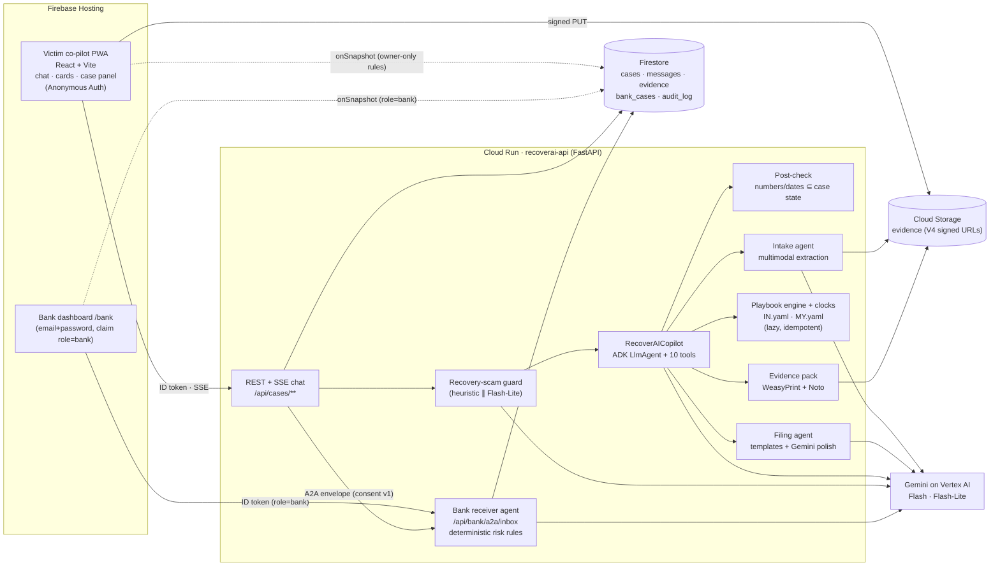

# RecoverAI

**A co-pilot that helps scam victims try to get their money back.** The victim chats in Hindi, Malay or English and uploads a payment screenshot, the scammer's messages or a voice note. RecoverAI then:

1. extracts the transaction facts with Gemini (multimodal, with confidence scores),
2. builds the country-specific recovery plan (India 1930 / NCRP / bank; Malaysia NSRC 997 / bank) from a YAML playbook,
3. drafts every complaint at once (hotline script, portal complaint, bank letter) and a Hindi-capable evidence-pack PDF,
4. tracks the legal deadlines and escalates on its own (RBI Ombudsman on day 31),
5. hands the case, with consent, to a **bank fraud-desk agent** over an A2A envelope. That agent scores mule-account signals with deterministic rules and recommends a temporary, amount-limited debit hold. A human analyst decides, and the victim sees the decision live.
6. A **recovery-scam guard** runs before the co-pilot on every message.

> **Disclaimer:** RecoverAI is a hackathon prototype. It drafts documents and reminders. It is not legal advice, it never handles money, and it never charges victims. All decisions are taken by government agencies and your bank. Every bank account, person and transaction in this repo is synthetic.

Rules, arithmetic, amounts and dates are computed **in code**, never by the model. The model writes prose, and a post-check verifies every number and date it emits against the case state before the text reaches the user.

---

## Architecture



* **Victim flow:** chat → Upload card → Facts card (confidence colours, editable) → Plan card + clocks → Drafts card + evidence pack → Consent card → bank. The case panel updates live through Firestore listeners.
* **Bank flow:** an A2A `fraud_case.submit` envelope reaches the receiver agent. Signals are computed per PRD §10 (VICTIM_REPORT, RECENT_TXN, NEW_ACCOUNT, FAN_IN, RAPID_OUTFLOW, FLAGGED_NUMBER, PROFILE_MISMATCH), giving a score, a level and an action. Gemini writes the reason, and the analyst approves, rejects or asks for more info. Every decision goes to `audit_log` and becomes a co-pilot message in the victim's language.
* **Security:** Firebase ID tokens are verified server-side. Firestore rules allow owner-only reads, bank-claim reads, and **no client writes**. Storage rules are deny-all, with uploads only through short-lived signed URLs. Evidence goes to Gemini inside `<evidence trust="untrusted">` fences with an injection guard. Each user gets 3 open cases and is rate-limited. No keys live in the repo: the deploy uses ADC and the Cloud Run service account.

## Repository layout

```text
backend/            FastAPI service (Cloud Run)
  app/main.py         app factory, routers, /healthz
  app/routers/        cases.py (victim API + SSE chat), bank.py (A2A inbox + dashboard API), local_blob.py (mock only)
  app/agents/         copilot.py (ADK root agent + tools + stage fallback), intake.py, playbook.py, filing.py,
                      deadline.py, guard.py, bank_receiver.py, voice.py, post_check.py
  app/rules/          engine.py (playbook engine + clocks), formatting.py (₹ lakh grouping, RM, timezones)
  app/bank/           rules.py (risk signals), data/ (synthetic accounts + high-risk numbers)
  app/pdf/            evidence_pack.py (WeasyPrint, Noto Devanagari)
  app/analytics/bq.py S2 stub (not built)
  agent_engine/       S1 stub (not built)
  playbooks/          IN.yaml, MY.yaml
  tests/              pytest suite (55 tests)
  Dockerfile, requirements.txt
frontend/           React 19 + Vite 7 + TS (Firebase Hosting)
  src/copilot/        Chat, MessageList, InputBar (text / mic / attach)
  src/cards/          Upload, Facts, Plan, Drafts, Consent, Timeline, Escalation, Warning, Countries
  src/panel/          CasePanel
  src/bank/           BankApp, Inbox, CaseDetail, ScamIntelligence (S2 placeholder)
  src/i18n/           en.json, hi.json, ms.json
fixtures/           synthetic evidence (UPI + bank screenshots, WhatsApp/SMS text, Hindi voice note) + expected JSON
scripts/            seed.py, make_bank_user.py, e2e_demo.py, reset_demo.py, make_fixtures.py, ui_smoke.py
deploy/deploy.sh    one-command GCP + Firebase deploy
docs/screenshots/   UI snapshots (generated by scripts/ui_smoke.py)
firebase.json  .firebaserc  firestore.rules  storage.rules  cors.json  .env.example
```

## Run locally (offline mock mode, with no GCP account)

Mock mode swaps Firestore and GCS for a JSON-file store and HMAC-signed local blobs, and swaps Gemini for deterministic fixture-aware stubs. Auth becomes `Bearer mock:<uid>`. Every demo scene works offline.

```bash
# backend (Python 3.12+; WeasyPrint needs pango: apt install libpango-1.0-0 libpangoft2-1.0-0 fonts-noto-core)
cd backend
python -m venv .venv && . .venv/bin/activate
pip install -r requirements.txt -r requirements-dev.txt
MOCK_MODE=true DEMO_MODE=true LOCAL_DATA_DIR=.localdata uvicorn app.main:app --port 8080

# frontend (Node 20+), in another terminal
cd frontend
npm ci
VITE_MOCK=true VITE_DEMO_MODE=true npm run dev        # http://localhost:5173  (Vite proxies /api → :8080)
```

Open http://localhost:5173 for the victim co-pilot and http://localhost:5173/bank for the bank desk. In mock mode the bank login takes any analyst name.

To run local mode against **real** Gemini, set `MOCK_MODE=false` and `AUTH_MODE=mock`, plus `GOOGLE_CLOUD_PROJECT`, after `gcloud auth application-default login`. This also needs Firestore and the bucket. See `.env.example`.

## Tests

```bash
cd backend && pytest                              # 55 passed, 1 skipped (live-Gemini test skipped offline)
python ../scripts/e2e_demo.py --mock              # both storylines over HTTP against the local backend
python ../scripts/ui_smoke.py                     # headless-browser run of the India + bank story; writes docs/screenshots/
cd ../frontend && npm run build
```

The suite covers the playbook engine, deadlines (`effective_from` against the incident's local date, timezones), amount and lakh formatting, digit and scale-word normalisation in the post-check, lazy-clock idempotence (escalation posts exactly once), recovery-scam guard wiring (warning before any token, on chat and on pasted evidence), the draft string-check (UTR, amount and VPA in every draft in both languages), extraction against every fixture, the injection fixture, the Hindi PDF, bank rules, the ADK co-pilot with a scripted fake LLM, and the full IN and MY API storylines.

## Deploy to Google Cloud

**You need:** a GCP project with **billing enabled**, and an account with Owner (or Editor + Firebase Admin + Service Usage Admin) on it. Install `gcloud`, `firebase-tools` (`npm i -g firebase-tools`), Node 20+, Python 3.12+, `jq` and `openssl`.

```bash
gcloud auth login
gcloud auth application-default login     # used by seed / make_bank_user scripts
firebase login

PROJECT_ID=<your-project-id> REGION=asia-south1 ./deploy/deploy.sh
```

`deploy.sh` is idempotent. Subcommands are `all` (default), `platform`, `backend`, `frontend` and `seed`. A full run does the following:

1. Enables the Run, Vertex AI, Firestore, Storage, Cloud Build, Artifact Registry, IAM Credentials, Firebase and Identity Toolkit APIs.
2. Creates Firestore (Native) and the evidence bucket, with CORS from `cors.json` and a 90-day delete lifecycle (synthetic demo data).
3. Creates the `recoverai-api` service account with least-privilege roles. It signs URLs through IAM `signBlob`, so no key files are needed.
4. Adds Firebase to the project, creates the web app, and turns on Anonymous and Email/Password sign-in.
5. Generates the A2A shared token into the git-ignored `deploy/.state/`.
6. Runs `gcloud run deploy --source backend` with min 1 instance, a 300 s timeout, `MOCK_MODE=false` and `AUTH_MODE=firebase`.
7. Seeds the synthetic bank accounts and creates the demo analyst with a generated password and claim `role=bank`.
8. Builds the frontend with the Firebase web config and deploys Hosting plus Firestore rules (`/api/**` is rewritten to Cloud Run).

Useful env overrides: `GEMINI_LOCATION` (default `global`), `GEMINI_MODEL` and `GEMINI_LITE_MODEL` (check that the IDs are available to your project in Vertex AI Model Garden), `DEMO_MODE` (default `true`), and `BANK_USER_EMAIL`.

After deploying:

```bash
API_BASE=$(cat deploy/.state/run_url) .venv/bin/python scripts/e2e_demo.py      # must print "E2E OK"
GOOGLE_CLOUD_PROJECT=<id> MOCK_MODE=false .venv/bin/python scripts/reset_demo.py --yes   # before recording / judging
```

Live URLs: `https://<PROJECT_ID>.web.app` (victim) and `https://<PROJECT_ID>.web.app/bank` (analyst; password in `deploy/.state/bank_password`).

## Demo script (≈3 min, PRD §4)

1. **India.** Open the app, choose *India* and *हिन्दी*, then tap *मेरे साथ ठगी हुई*. Type `मैंने CBI वाले को 1,95,000 भेज दिए`. On the Upload card, attach `fixtures/in_upi_success.png` and paste `fixtures/in_whatsapp_scam.txt`, then tap *मेरे सबूत पढ़ें*. The Facts card appears with the bank field flagged amber; fix it and tap *✓ सही है*. The Plan card follows (call 1930 now, NCRP, bank, and the 5-day RBI clock shown as **recommended** because the rule starts on 1 Jan 2027). Tap *✍️ सब तैयार करें* to get the drafts and evidence pack, then the consent card. Tap *✓ मेरे बैंक से साझा करें*.
2. **Bank.** In a second window open `/bank` and sign in. The new case sits on top as **HIGH**, with the reason and signals. Click *Approve temporary hold*. Within a few seconds Priya's chat shows "अस्थायी रोक…" and the panel badge updates.
3. **Malaysia.** Switch the country to *Malaysia* and the language to *Bahasa Melayu*, start a new case and use `my_bank_transfer.png` + `my_sms.txt`. The plan shows *Call NSRC 997* (it counts as your police report) and the bank fraud line, with drafts in Malay and English.
4. **Escalation.** In Priya's case panel, open *Demo time-travel* and click *Jump to day 31*. An Escalation card appears with the RBI Ombudsman complaint, already filled with the bank reference and complaint date.
5. **Recovery-scam guard.** Type `Pay ₹5,000 fee and we recover your money`. A red Warning card appears before any reply.
6. **Honest answer.** Ask "Will I definitely get my money back?". You get no promises, only the conditions taken from the playbook.

Screenshots are in [`docs/screenshots/`](docs/screenshots).

## Status: not built or stubbed

* **S1 Agent Engine + Memory Bank:** not built (PRD: only after M8 is deployed). `COPILOT_RUNTIME=cloudrun` is the only runtime, and `backend/agent_engine/deploy.py` is a stub.
* **S2 BigQuery scam intelligence:** not built. `/api/bank/analytics` returns 501, and the dashboard tab says so.
* Real bank, NCRP and NSRC integrations are out of scope ([WON'T]). The "Coming soon" countries are display-only.
